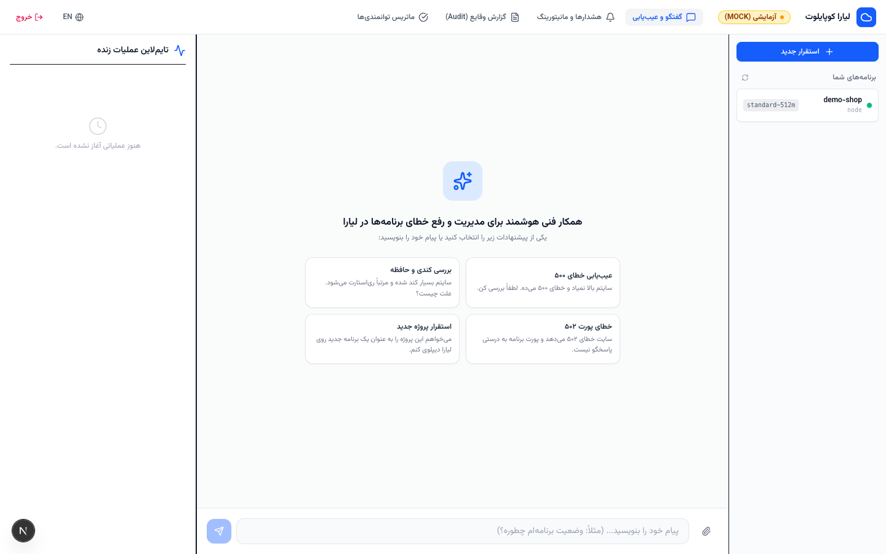
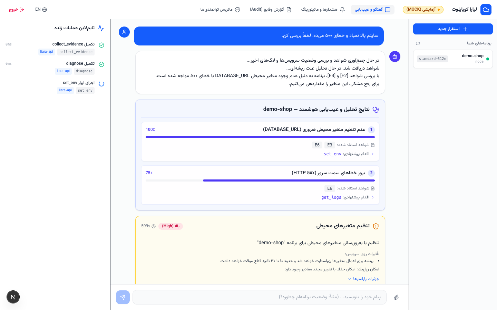
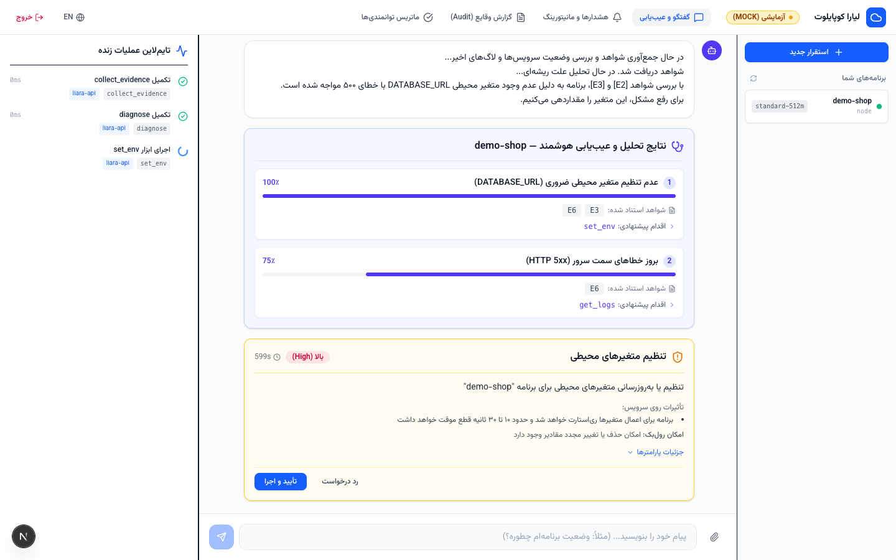
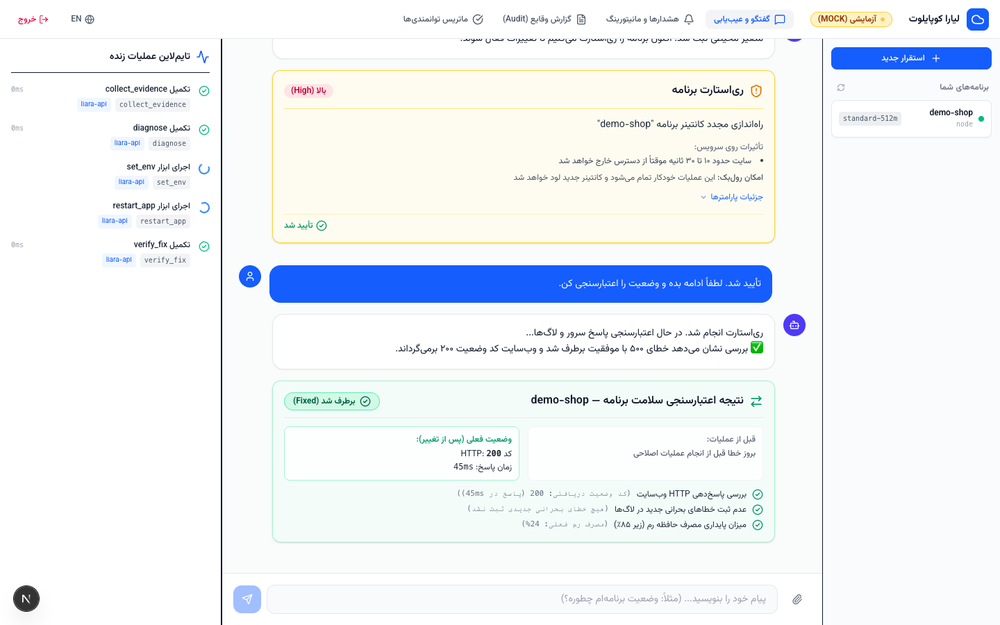
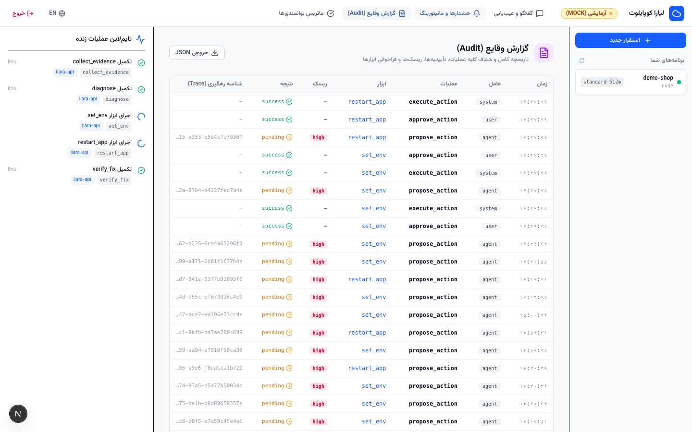

# Liara Copilot — دستیار فنی هوشمند برای سایت‌های روی لیارا 🚀

[](https://github.com/liara-cloud)
[]()
[]()
[](https://liara.ir)

**لیارا کوپایلوت (Liara Copilot)** یک همکار فنی و باحوصله هوش مصنوعی برای صاحبان کسب‌وکار و وب‌مسترها بر روی ابر **لیارا** است. این ابزار به کاربران کمک می‌کند بدون درگیری با مفاهیم پیچیده دواپس، برنامه‌های خود را با چند کلیک مستقر کرده، به صورت خودکار مانیتور کنند و در صورت بروز خطا با تشخیص ریشه‌ای مبتنی بر شواهد و اعتبارسنجی خودکار، مشکلات را برطرف نمایند.



---

## 📸 تصاویر رابط کاربری و کارت‌های هوشمند / Visual Tour

| کارت تشخیص هوشمند (Diagnosis) | کارت تأیید سروری (Approval Gate) |
|---|---|
|  |  |

| کارنامه اعتبارسنجی سلامت (Verification) | گزارش وقایع و ممیزی (Audit Log) |
|---|---|
|  |  |

---

## 🌟 ویژگی‌های کلیدی / Key Features

1. **استقرار از صفر تا صد (Deploy from Zero):**
   - شناسایی خودکار فریم‌ورک و پلتفرم پروژه (Node.js, Next.js, Python, Django, Flask, PHP, Laravel, Docker, Flutter Web)
   - پیشنهاد پلن سخت‌افزاری بهینه متناسب با بودجه و نیاز منابع
   - ایجاد خودکار برنامه، تنظیم متغیرها، استقرار و بررسی پاسخ‌دهی HTTP وب‌سایت

2. **عیب‌یابی هوشمند مبتنی بر شواهد (Evidence-First Troubleshooting):**
   - گردآوری هم‌زمان شواهد: لاگ‌های سرور، متریک‌های مصرف CPU و RAM، وضعیت کانتینر، پروب پاسخ‌دهی و متغیرهای محیطی
   - تشخیص علل ریشه‌ای (مانند عدم تنظیم متغیرهای محیطی `missing_env`، پر شدن حافظه `OOM Kill`، عدم تطابق پورت `wrong_port`، خطای اتصال دیتابیس `db_connection` و پر شدن دیسک `disk_full`)
   - استناد قطعی به شناسه‌های شواهد (`[E1]`, `[E2]`) بدون اختراع یا توهم مدل زبانی

3. **حلقه اعتبارسنجی قبل و بعد (Verification Loop):**
   - مقایسه دقیق قبل و بعد از اعمال تغییرات با صدور کارنامه سلامت (`fixed`، `improved`، `unchanged`، `worse`)
   - آزمایش پاسخ‌دهی لایو HTTP، سلامت لاگ‌های پس از ری‌استارت و میزان سرانه حافظه

4. **امنیت تضمین‌شده در سمت سرور (Server-Enforced Safety):**
   - طبقه‌بندی ابزارها در سه سطح ریسک: `read` (خواندنی)، `low` (کم‌ریسک)، `high` (پرریسک مانند ری‌استارت، دیپلوی، تغییر پلن یا متغیرها)
   - **گیت تأیید در سطح کد سرور:** اقدامات پرریسک بدون تأیید صریح کاربر در پنل هرگز اجرا نمی‌شوند.
   - ضد جعل (Tamper Proof): هش SHA-256 پارامترها ذخیره شده و قبل از اجرا اعتبارسنجی مجدد می‌شود.
   - حفاظت در برابر Replay و انقضای ۵ دقیقه‌ای کارت‌های درخواست تأیید
   - فیلتر و ممیزی کامل داده‌های حساس (`redact`): حذف خودکار توکن‌ها، رمزها، رشته‌های اتصال دیتابیس و مقادیر حساس محیطی

5. **پشتیبانی کامل آفلاین (Mock-First Architecture):**
   - شبیه‌ساز پایدار Liara API و مدل زبانی فیلمنامه‌نویسی‌شده (Scripted LLM) جهت اجرای تمامی سناریوهای تستی و دمو با صفر کردینشال و بدون نیاز به اینترنت

6. **سرور MCP رسمی (Model Context Protocol):**
   - امکان اتصال مستقیم به Claude Desktop، Cursor، Windsurf و سایر کلاینت‌های هوش مصنوعی

---

## 🏗️ معماری سیستم / Architecture

```
                       ┌────────────────────────────────────────┐
                       │     مرورگر کاربر (Next.js 16 - RTL)    │
                       └───────────────────┬────────────────────┘
                                           │ HTTP + SSE (Same-Origin Proxy)
                       ┌───────────────────▼────────────────────┐
                       │        Fastify API Server (Port 3001)  │
                       ├────────────────────────────────────────┤
                       │  • احراز هویت با Passcode و سشن امن     │
                       │  • موتور استریم چت SSE                 │
                       │  • گیت سروری تأیید اقدامات (PendingAction)│
                       │  • زمان‌بند مانیتورینگ خودکار            │
                       │  • پایگاه داده SQLite (ممیزی و سوابق)   │
                       └───────────┬────────────────┬───────────┘
                                   │                │
            ┌──────────────────────▼──────┐   ┌─────▼──────────────────┐
            │       موتور عامل هوشمند     │   │     ماتریس ابزارها      │
            │      (@copilot/agent)       │   │    (@copilot/tools)    │
            │  • حلقه استدلال و ابزارها   │   │  • ممیزی و Redaction   │
            │  • دیتکتورهای مبتنی بر قانون│   │  • ارزیابی سطح ریسک    │
            │  • اعتبارسنجی فرضیات و مدرک │   │  • کارت‌های فارسی تأیید│
            └──────────────┬──────────────┘   └─────┬──────────────────┘
                           │                        │
            ┌──────────────▼──────────────┐   ┌─────▼──────────────────┐
            │   آداپتور مدل زبانی (LLM)   │   │     کلاینت رسمی لیارا   │
            │  • OpenAI-Compatible API    │   │ (@copilot/liara-client)│
            │  • فال‌بک اکشن‌های JSON     │   │  • REST API Client     │
            │  • Mock Scripted Simulator  │   │  • Liara CLI Driver    │
            │                             │   │  • شبیه‌ساز سناریوها   │
            └─────────────────────────────┘   └────────────────────────┘
```

---

## 🔌 نحوه اتصال به APIهای لیارا / Connecting to Liara APIs

- **احراز هویت و توکن:** از طریق کنسول لیارا (بخش API) توکن اختصاصی تولید شده و در متغیر `LIARA_API_TOKEN` قرار می‌گیرد. در حساب‌های تیمی، شناسه تیم در `LIARA_TEAM_ID` تنظیم می‌شود.
- **آدرس پایه API:** درخواست‌ها به `https://api.liara.ir` (و برای سرویس DNS به `https://dns-service.liara.ir`) با هدر استاندارد `Authorization: Bearer <token>` ارسال می‌شوند.
- **وضعیت تطابق اندپوینت‌ها:** کلیه اندپوینت‌ها در جدول `docs/LIARA_CAPABILITIES.md` و مستند `docs/LIARA_API.md` بر اساس اسپک‌های رسمی OpenAPI 3.0 لیارا مستند شده‌اند.
- **درایور CLI برای استقرار (CLI Deploy Fallback):** از آنجا که آپلود مستقیم فایل‌های سورس از طریق REST API نیاز به پکیجینگ دارد، درایور مجزای `LiaraCliDriver` با استفاده از ابزار خط فرمان رسمی `liara deploy` سورس را مستقر کرده و لاگ‌های بیلد را به صورت لحظه‌ای استریم و سانسور می‌کند.

---

## 🛡️ مدل ایمنی و حریم خصوصی / Safety Model

| سطح ریسک | رفتار سیستم | ابزارها |
|---|---|---|
| **`read`** | اجرای خودکار و ثبت در لاگ ممیزی | `list_apps`, `get_app`, `get_logs`, `get_metrics`, `list_env`, `list_plans`, `check_http`, `dns_lookup`, `collect_evidence`, `diagnose`, `verify_fix` |
| **`low`** | اجرای خودکار با اطلاع‌رسانی در تایم‌لاین | `create_app` (ایجاد برنامه خالی) |
| **`high`** | **تنها پیشنهاد و تولید کارت تأیید**؛ اجرا صرفاً با تأیید صریح کاربر | `deploy`, `restart_app`, `stop_app`, `start_app`, `set_env`, `unset_env`, `change_plan`, `add_domain` |

- **سانسور خودکار (`redact`):** تمامی خروجی‌های لاگ، پروب‌های شبکه و متغیرها قبل از ارسال به مدل زبانی یا نمایش در فرانت‌اند پالایش می‌شوند. مقادیر متغیرها به جز کلیدهای مجاز (`NODE_ENV`, `PORT`, `TZ`, `LOG_LEVEL`) با `‹redacted›` جایگزین می‌شوند.
- **لاگ ممیزی کامل (`/audit`):** تک‌تک فراخوانی‌ها، عامل اجرا (کاربر/عامل/مانیتور)، ریسک و خروجی ثبت و با فرمت JSON قابل دانلود است.

---

## ⚠️ محدودیت‌های فنی و شفافیت / Limitations

1. **امکانات غیرقابل انجام با API (Manual Steps):** اتصال دامنه و تنظیم رکوردهای DNS یا نیم‌سرورها در پنل رجیسترار (مانند ایرنیک) باید به صورت دستی توسط کاربر انجام شود؛ کوپایلوت برای این موارد چک‌لیست گام‌به‌گام ارائه می‌دهد.
2. **استریم زنده لاگ‌ها:** در حال حاضر روی REST API پشتیبانی نشده و پیشنهاد استفاده از `liara app:logs -f` ارائه می‌شود.
3. **ذخیره‌سازی پایگاه داده:** پایگاه داده ممیزی و مکالمات SQLite در پوشه `DATA_DIR` ذخیره می‌شود. در استقرار ابری روی لیارا، توصیه می‌شود یک دیسک (Disk) اختصاصی به این مسیر متصل گردد.
4. **تک‌کاربره (Single User):** احراز هویت نسخه MVP بر اساس یک گذرواژه مشترک امنیتی (`APP_PASSCODE`) برای حفظ امنیت زیرساخت است.

---

## 💬 سناریوهای آماده و پرامپت‌های پیشنهادی / Example Prompts

| سناریو | پرامپت کاربر | نتیجه تشخیصی و اقدام |
|---|---|---|
| **خطای ۵۰۰ به دلیل متغیر محیطی** | «سایتم بالا نمیاد و خطای ۵۰۰ می‌ده. لطفاً بررسی کن.» | یافتن `Missing required env DATABASE_URL` در لاگ -> کارت تأیید `set_env` -> ری‌استارت -> اعتبارسنجی ۲۰۰ |
| **کندی سرعت و اشباع رم** | «سایتم بسیار کند شده و مرتباً ری‌استارت می‌شود.» | تشخیص مصرف رم بالای ۹۰٪ و OOM Kill -> کارت تأیید ارتقای پلن `change_plan` -> اعتبارسنجی کاهش رم به زیر ۵۰٪ |
| **خطای ۵۰۲ و پورت اشتباه** | «سایت پیام 502 Bad Gateway می‌دهد و در دسترس نیست.» | کشف شنود روی پورت ۸۰۸۰ در لاگ -> اصلاح متغیر `PORT=3000` -> ری‌استارت -> برطرف شدن ۵۰۲ |
| **استقرار پروژه جدید** | «می‌خواهم این پروژه را به عنوان یک برنامه جدید روی لیارا دیپلوی کنم.» | آنالیز ساختار -> پیشنهاد پلن مناسب -> ساخت برنامه -> دیپلوی سورس -> بررسی سلامت پاسخ وب‌سایت |
| **خطای دیتابیس خارجی** | «دیتابیس در دسترسم نیست و خطای ارتباطی دارم.» | توضیح صادقانه مبنی بر قطع بودن سرور دیتابیس و عدم امکان تعمیر خودکار، بدون وعده دروغین |

---

## 🚀 نحوه راه‌اندازی و اجرای محلی / Getting Started

### ۱. نصب وابستگی‌ها
```bash
# نیاز به Node.js 22+ و pnpm
corepack enable
pnpm install
```

### ۲. اجرای تست‌ها و بررسی کیفیت کد
```bash
pnpm test        # اجرای ۵۰ تست جامع روی تمام پکیج‌ها
pnpm typecheck   # بررسی دقیق تایپ‌های TypeScript
pnpm lint        # بررسی قواعد ESLint و استایل Prettier
pnpm build       # بیلد تمامی پکیج‌ها و برنامه وب Next.js
```

### ۳. اجرای سناریوهای دمو به صورت آفلاین و بدون کردینشال
```bash
pnpm scenario missing_env_500 --auto-approve
pnpm scenario memory_leak_oom --auto-approve
pnpm scenario wrong_port --auto-approve
pnpm scenario fresh_project --auto-approve
pnpm scenario db_down --auto-approve
pnpm scenario api_gap --auto-approve
```

### ۴. اجرای برنامه سرور و فرانت‌اند (حالت توسعه)
```bash
cp .env.example .env
# در فایل .env حالت‌های پیش‌فرض LIARA_MODE=mock و LLM_MODE=mock تنظیم شده‌اند.

pnpm dev
# وب‌اپلیکیشن کاربری: http://localhost:3000 (رمز عبور پیش‌فرض: change-me)
# سرور ای‌پی‌آی: http://localhost:3001
# فروشگاه نمونه تستی: http://localhost:3002
```

### ۵. تست خودکار رابط کاربری در مرورگر واقعی (E2E Browser Test)
```bash
# اجرای خودکار تست GUI با مرورگر Chrome و ثبت اسکرین‌شات‌ها
pnpm tsx scripts/e2e-gui-test.ts
```

### ۶. پروب قابلیت‌های لایو (Live Probe)
```bash
# پس از ثبت LIARA_API_TOKEN در .env:
pnpm probe
# برای آزمایش ساخت و حذف برنامه آزمایشی:
pnpm probe --allow-write
```

---

## 🤖 تنظیم سرور MCP برای Claude Desktop / Cursor

برای اضافه کردن لیارا کوپایلوت به نرم‌افزار **Claude Desktop** یا **Cursor**:

فایل تنظیمات `claude_desktop_config.json`:
```json
{
  "mcpServers": {
    "liara-copilot": {
      "command": "node",
      "args": ["/ABSOLUTE/PATH/TO/liara-copilot/apps/mcp/dist/index.js"],
      "env": {
        "LIARA_MODE": "mock",
        "LIARA_API_TOKEN": "YOUR_TOKEN_HERE"
      }
    }
  }
}
```

---

## 📦 استقرار بر روی لیارا / Deployment on Liara

دستورالعمل کامل استقرار هر سه سرویس (`copilot-api`، `copilot-web`، و `demo-shop`) در مستند `docs/DEPLOYMENT.md` تشریح شده است.

---

## ⚖️ لایسنس
توسعه‌یافته برای مسابقه Liara AI Assistant MVP 2026.
